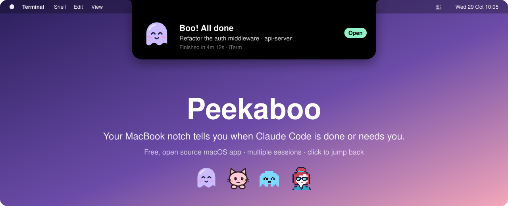
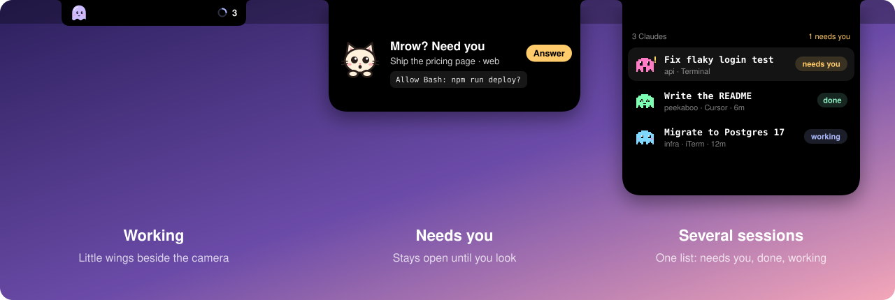
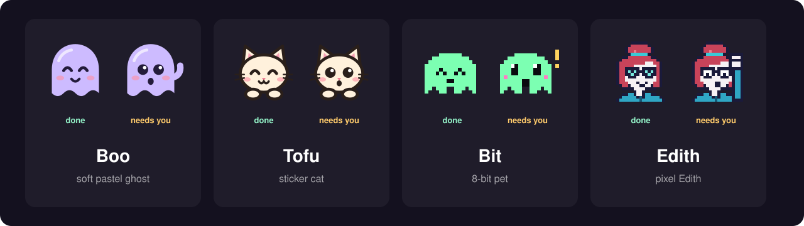
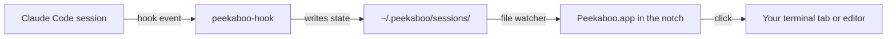

<div align="center">



# Peekaboo: Claude Code notifications in your MacBook notch

**A free, open source macOS app that turns the notch into a cute status light for Claude Code.** When a session finishes or needs your input, the notch springs open with a little buddy and tells you which one. Click it to jump straight back to the right terminal tab or editor window.

[](https://github.com/amirjf/peekaboo/releases/latest)
[](https://github.com/amirjf/peekaboo/actions/workflows/build.yml)
[](#requirements)
[](Package.swift)
[](LICENSE)

[Install](#install) · [Features](#features) · [How it works](#how-it-works) · [Add a buddy](#add-your-own-buddy) · [FAQ](#faq)

</div>

## Why Peekaboo?

You start Claude Code on a task, switch to something else, and forget about it. Ten minutes later you find out it finished long ago, or worse, it has been sitting on a permission prompt the whole time. With three or four sessions in different tabs it gets harder still.

Peekaboo fixes that by putting every Claude Code session right where your eyes already are: the notch at the top of your MacBook screen. It works like a Dynamic Island for your AI coding agents. No windows to keep open, no notification center to dig through.

## Install

```bash
curl -fsSL https://raw.githubusercontent.com/amirjf/peekaboo/main/install.sh | bash
```

The script downloads the latest release into `/Applications`, starts Peekaboo, and sets it to open at login. Peekaboo hooks itself into Claude Code on first launch, so all that's left is to **restart any Claude Code sessions that were already running**.

Prefer to do it by hand? Download `Peekaboo.zip` from the [latest release](https://github.com/amirjf/peekaboo/releases/latest), unzip it into `/Applications` and open it.

Want to see it before your next task finishes? Click the 👀 icon in the menu bar and choose **Play demo**.

### Requirements

- macOS 14 Sonoma or later (Apple silicon and Intel)
- [Claude Code](https://docs.anthropic.com/en/docs/claude-code) installed
- Best on a MacBook with a notch. On other displays Peekaboo appears at the top center of the screen, only when it has something to say.

## Features

- **Done and needs-you alerts in the notch.** The notch opens when a Claude Code session finishes ("Boo! All done") or is waiting on you, for example a permission prompt.
- **Click to jump back.** Peekaboo selects the exact Terminal or iTerm2 tab that runs the session, focuses the right VS Code, Cursor, Windsurf or Zed window, and brings Warp, Ghostty and other terminals to the front.
- **Made for multiple sessions.** Running several Claudes at once? Hover the notch to see them all in one list, sorted by what needs you first. Each session gets its own buddy color so you can tell them apart.
- **Live working indicator.** While Claude works, small "wings" sit either side of the camera with a spinner and a session count.
- **Choose your buddy.** Pick a mascot from the menu bar: Boo the ghost, Tofu the cat, Bit the 8-bit pet, or pixel Edith.
- **Polite by design.** Done cards tuck away after 6 seconds. Needs-you cards stay until you look. Sounds can be turned off, and Reduce Motion is respected.
- **Native and lightweight.** Written in Swift and SwiftUI, no Electron. It reads local files only: no account, no network calls, no telemetry.
- **Free and open source** under the MIT license.



| State | What you see in the notch |
| --- | --- |
| Nothing running | A normal notch |
| Working | Wings either side of the camera: your buddy on the left, a spinner and the session count on the right |
| Done | Opens with "All done", the task, and how long it took, then tucks away after 6 seconds |
| Needs you | Opens with Claude's question (like a permission prompt) and stays until you look |
| Several sessions | One list, sorted: needs you, then done, then working |

Approvals always happen in the Claude session itself. Peekaboo only tells you where to look; it never answers a prompt for you.

## Meet the buddies



| Buddy | Style | Done | Needs you |
| --- | --- | --- | --- |
| **Boo** (default) | Soft pastel ghost | "Boo! All done" | "Psst, I need you" |
| **Tofu** | Sticker cat with its paws on the notch | "Done! Purr" | "Mrow? Need you" |
| **Bit** | 8-bit pixel pet | "DONE!" | "NEED YOU!" |
| **Edith** | Pixel Edith with her hand-to-temple pose | "Task complete" | "Edith here: need you" |

Switch buddies any time from the 👀 menu bar icon. Each buddy has its own sounds, voice and motion.

## How it works



1. On first launch Peekaboo adds a small hook to `~/.claude/settings.json` for the `SessionStart`, `UserPromptSubmit`, `PostToolUse`, `Notification`, `Stop` and `SessionEnd` events. Your original file is backed up next to it as `settings.json.peekaboo-backup`, and your other hooks are left alone.
2. When one of those events fires, Claude Code runs `peekaboo-hook`. It writes the session's state (working, done, needs you), the task title and the folder to `~/.peekaboo/sessions/<id>.json`, then exits immediately. It never prints anything and always exits cleanly, so it can't slow Claude down.
3. Peekaboo watches that folder and animates the notch.
4. When you click a session, Peekaboo uses AppleScript to select the exact Terminal or iTerm2 tab (macOS asks for permission the first time). Editors are focused on the session's folder; other terminals are brought to the front.

Everything stays on your Mac.

## Menu bar options

The 👀 icon in the menu bar lets you:

- pick a buddy
- turn sounds on or off
- turn open at login on or off
- play a demo
- reinstall the Claude Code hooks (handy if another tool rewrote your settings)
- quit Peekaboo

## Add your own buddy

Buddies are skins: every buddy has the same four moods (idle, working, done, needs you) and brings its own drawing, colors, voice and sounds. New buddies are very welcome as pull requests.

1. Add a case to the `Buddy` enum in [`Sources/Peekaboo/Buddy.swift`](Sources/Peekaboo/Buddy.swift) and fill in its `name`, three session `tints`, `doneHeading`, `needsHeading`, and the system sounds for `doneSound` and `needsSound`.
2. Draw it in [`Sources/Peekaboo/BuddyView.swift`](Sources/Peekaboo/BuddyView.swift). Vector buddies draw into a 64×64 canvas (see `BooArt` and `TofuArt`). Pixel buddies use a character map and `PixelGrid` (see `BitArt` and `EdithArt`), and set `isPixel` to get the monospaced font and stepped motion.
3. Handle all four moods, and keep motion subtle: a gentle bob, a blink, a wave for "needs you".
4. Build it, choose your buddy from the menu bar and use **Play demo** to see every state.
5. Open a pull request with a screenshot or short GIF of your buddy in the notch.

Please only submit artwork you made yourself or have the right to share.

## Build from source

```bash
git clone https://github.com/amirjf/peekaboo.git
cd peekaboo
scripts/build-app.sh      # needs the Xcode 15+ command line tools
open build/Peekaboo.app
```

The project is a plain Swift package with three targets:

| Target | What it is |
| --- | --- |
| `Peekaboo` | The menu bar and notch app (SwiftUI + AppKit) |
| `peekaboo-hook` | The tiny command Claude Code runs on each hook event |
| `PeekabooCore` | Session records and process lookup shared by both |

Every push to `main` builds a universal (Apple silicon + Intel) release on GitHub Actions, which is what the install script downloads.

## Contributing

Bug reports, ideas and pull requests are welcome, from new buddies to support for more terminals and editors. Open an [issue](https://github.com/amirjf/peekaboo/issues) to talk about bigger changes first. If Peekaboo saves you a few context switches, a ⭐ helps other Claude Code users find it.

## Uninstall

1. Quit Peekaboo from the 👀 menu bar icon.
2. Delete `/Applications/Peekaboo.app`.
3. Remove the `peekaboo-hook` entries from `~/.claude/settings.json` (or restore `settings.json.peekaboo-backup` if you haven't changed your settings since).
4. Delete `~/.peekaboo`.

## FAQ

**Does Peekaboo work without a notch?**
Yes. On an external display or a Mac without a notch, it shows up at the top center of the screen only when a session is done or needs you.

**Which terminals and editors can it jump to?**
Terminal and iTerm2 jump to the exact tab. VS Code, VS Code Insiders, Cursor, Windsurf, Zed and VSCodium open the window for the session's folder. Warp, Ghostty and other apps are brought to the front.

**Does it send my prompts or code anywhere?**
No. The hook writes a small JSON file to `~/.peekaboo` on your Mac and the app reads it. Peekaboo makes no network requests.

**Will it break my existing Claude Code hooks?**
No. Peekaboo only adds and replaces its own entries in `~/.claude/settings.json` and keeps a backup of the original. If your settings file isn't valid JSON, it leaves it untouched.

**Do I have to restart Claude Code?**
Only sessions that were already running when you installed Peekaboo. New sessions pick up the hook automatically.

**Why does macOS ask for Automation permission?**
That's how Peekaboo selects the right Terminal or iTerm2 tab when you click a session. If you say no, it still brings the app to the front.

**Is this an official Anthropic app?**
No. Peekaboo is an independent open source project built for Claude Code users.

## License

Peekaboo is released under the [MIT License](LICENSE).
